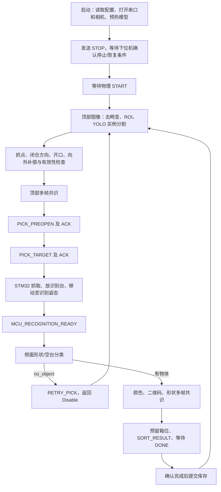

# 智能分拣系统工作交接文档

更新日期：2026-11-02。

本文交接的是上下位机一体化工程，内容以远端 **`dsh/fix-axis-swap`** 分支的源码为准。本文检查的代码基线为 **`2ef508645dfa624267f91cce19aeca45c0952c1c`**，提交说明为 `grasp: report how far the closest candidate was from fitting between the fingers`。文档整理期间远端又更新了两次，已核对并纳入下面的开口和诊断说明。后续新增的文档提交不改变这个代码基线。

**当前最需要交接的结论：系统已有完整分拣链路，但“图像中的物体在左下角，机构却走到右上角”的实机坐标问题尚未取得闭环验证；不能把它写成已经修复。当前分支还存在上下位机 Yaw 参数不一致、部分配置未实际生效和回归测试失败。下一步应先统一坐标与标定，再调整抓取策略和速度。**

## 1. 工程位置与版本依据

仓库：<https://github.com/withSolitude/smart_sorting_vision>。

| 项目 | 位置或说明 |
|---|---|
| 当前维护分支 | `dsh/fix-axis-swap`；用户所说的“dsh 分支”实际是这个完整名称 |
| 用户确认的本地下位机工程 | `E:\gongxun\code\smart_sorting_vision\Control_fixed` |
| 上述仓库内的视觉工程 | `E:\gongxun\code\smart_sorting_vision\smart_sorting_vision` |
| 另一个历史工作区 | `E:\gongxun\code\smart_sorting_vision_main_work`；不能直接视为最新版本 |
| 本地独立 SAM3 工作目录 | `E:\gongxun\27\sam3`；仓库内另有 `tools/sam3` 工具副本 |
| Jetson 常用实际运行目录 | 之前日志为 `~/smart_sorting_vision`；应现场确认它是仓库目录、子目录还是复制出来的运行目录 |

交接检查时，用户指定的本地仓库仍停在旧的 `codex/robust-reconnect-cleanup`，并有下位机未提交修改和备份文件；它与远端 `dsh/fix-axis-swap` **不是同一个完整快照**。本次采用独立工作区检查远端代码，保留了原目录中的调试修改。接手者不要只看文件夹名字判断版本。

在包含 `.git` 的仓库根目录核对：

```bash
git branch --show-current
git rev-parse HEAD
git status --short
git remote -v
```

工作区干净时更新当前维护分支：

```bash
git fetch origin
git switch dsh/fix-axis-swap
git pull --ff-only origin dsh/fix-axis-swap
```

如果存在调好的未提交参数，先保存补丁和参数副本，再处理分支切换。不要用覆盖整个工程的方法更新，也不要把虚拟环境、模型和旧的构建目录一起提交。

### 1.1 哪些内容不随代码自动同步

本次检查的 Git 快照中，没有跟踪 `smart_sorting_vision/data/calibration`、`data/datasets` 和 `outputs` 下的实际标定、数据集、模型文件。**下载分支不等于下载了 Jetson 当前有效的标定和模型。**

至少另行保存：

- 现场 `config/runtime_config.yaml`。
- `top_camera_intrinsics.npz`、实际使用的 `pixel_to_robot.json`、采样点和验证报告。
- Yaw 标定报告、预开口测量记录、侧面背景图。
- `.pt` 权重、对应 `.engine`、训练 `args.yaml`、`data.yaml` 与类别顺序。
- 当前 STM32 固件对应的提交号和机械参数，以及一次完整运行日志。

## 2. 系统现在采用的思路

机械部分是 **CoreXY 平移 + Yaw 转向 + Lift 升降 + 平行二指夹爪**。顶部 RGB 相机负责找物体和规划抓取；TOF050F 在两指下部中间朝下，给下降过程提供单点距离；侧面 RGB 相机在物体放到识别台后判断属性；STM32 控制执行机构和分箱。

目前正式流程没有接入 D455 深度数据，没有完整三维场景重建，也没有使用“完整物体模型 + 顶面模型”的双模型抓取链路。顶部仍按**物体完整可见轮廓**进行实例分割，轮廓可能同时包含顶面和侧面。



软件职责：

| 层 | 主要职责 | 关键文件 |
|---|---|---|
| 应用初始化 | 配置、资源检查、设备初始化、预热、UI | `smart_sorting_vision/main.py` |
| 比赛调度 | 收发握手、周期状态、重试、离线恢复、分箱事务 | `smart_sorting_vision/runtime/sorting_runtime.py` |
| 顶部视觉 | 分割、候选点/方向/宽度、补偿、候选过滤 | `smart_sorting_vision/vision/pipeline/top_pick_pipeline.py` |
| 顶部共识 | 抓点和角度的多帧稳定判断 | `smart_sorting_vision/vision/pipeline/top_pick_consensus.py` |
| 侧面视觉 | 形状分类、空台、颜色、二维码 | `smart_sorting_vision/vision/pipeline/side_sort_pipeline.py` |
| 下位机调度 | 协议事务、抓取流程、标定动作、储物流程 | `Control_fixed/User_File/4_Interaction/ita_robot.cpp`、`ita_sorting_handshake.cpp` |
| 夹爪总成 | XY/Yaw/Lift/Claw 状态机、TOF 下降、待机回程 | `Control_fixed/User_File/3_Robot/holding_jaw.cpp` |
| XY 执行 | CoreXY 换算、步进驱动命令、反馈、到位和停车 | `Control_fixed/User_File/3_Robot/xy_motion.cpp` |

## 3. 下位机驱动与运动逻辑

### 3.1 EMM 步进驱动

两台张大头 EMM V5 步进驱动器使用 **CAN2、1 Mbps、地址 1 和 2**；CAN1 留给原有 DM4310 总线。Jetson 与 STM32 使用的是 **115200 波特率 UART**，它与电机 CAN 速率是两回事。

EMM 驱动使用经典 CAN 扩展帧、固定校验字节 `0x6B`。代码没有自动配置驱动器的全部波特率/细分等参数；驱动器设置、STM32 的 FDCAN 时序与配置常量必须匹配，不能仅改一个 `CAN_Baud` 常量就认为通信速率已切换。

主要配置在 `Control_fixed/User_File/3_Robot/xy_motion_config.h`：

| 参数 | 当前分支值 | 含义 |
|---|---:|---|
| `Frame_Rotation_Deg` | `0.0` | 当前实机应保持正交 CoreXY，用户确认改成 45° 会沿对角线走 |
| `Direction_A` / `Direction_B` | `1` / `1` | 电机正方向约定 |
| `Travel_Per_Rev_A_mm` / `B` | `π × 12` | 当前代码值；其注释仍提示待标定，不能当作已测准 |
| 步距角 / 细分 | 200 步/转、16 细分 | 对应 3200 脉冲/转，驱动器参数必须匹配 |
| `Max_RPM` / `Acceleration` | `300` / `45` | 当前运行参数，非低速首次调试参数 |
| MCU XY 工作区 | X `[-770,700]`、Y `[-800,550]` mm | 明显大于上位机当前 `[-300,0]`，尚未统一 |
| `Mechanical_Calibration_Confirmed` | `true` | 只是配置解锁，不证明方向和传动比例正确 |

当前 `Frame_Rotation_Deg=0` 时：

```text
A = Direction_A × (X + Y)
B = Direction_B × (X - Y)
```

驱动及 XY 协调层已有 CAN 指令编码、反馈解析、单圈跨圈累计、多圈位置反馈、双电机命令应答与同步、真实位置/速度到位判定、反馈失联与停车确认等实现。不能只依据收到命令 ACK 判断机械已经到位。

### 3.2 原点与多圈

当前采用**上电位置作为软件零点**：等待两台电机反馈有效、停稳且没有相应故障后，记录当时电机位置为 XY 原点。不主动撞挡块，不把电机自动旋转到某个单圈编码角。

这意味着：

1. 每次上电前，机构实际位置应与视觉标定采用的机械零点一致。
2. 电机编码器单圈位置、多圈累计量与“机械 XY 零点”是不同概念。
3. 软件跨圈计数依赖反馈连续性；不能把它当作断电后仍保存的绝对多圈机械位置。
4. 电机掉电、被手推或原点失效后，要重新确认位置与零点，不能仅等串口重新连上。

当前 XY 主位置来源是驱动器 `0x36` 的有符号多圈位置；`0x31` 单圈编码器另外进行软件跨圈展开，用于独立诊断，不能把两者混为同一位置源。单圈展开遇到采样间隔过长或恰好半圈的歧义时会置无效，不猜测漏掉了多少圈。

`Driver_Collision_Homing_Enabled=false`。当前文件中仍有过去 `+45°` 下“先单独 B(X)，再 A(Y)”的旧注释，碰撞回零路径也需要重新审查。**不要直接打开这个开关当作当前标准 CoreXY 可用的自动回零方案。**

### 3.3 夹爪预开口

上位机从完整 mask 在候选闭合方向上估算宽度，形成：

```text
目标预开口 = 估算物体宽度 + margin_mm
舵机角度 = closed + (standby - closed) × 目标预开口 / max_gap
```

当前 YAML 中 `margin_mm=14`，净开口协议范围 `13..77 mm`。`0b16bd7` 将总余量从 8 增加到 14 mm，用于给补偿后偏心抓点留出更多两侧开口；实际可抓取宽度上限也会因此受影响，仍需实测。下位机 `claw_preopen_profile.h` 的两个端点为：

```text
closed  =  0.710004610°
standby = -89.283079760°
```

这是 **Claw 开合舵机**，不是 Yaw。正式流程先发送 `PICK_PREOPEN`，收到锁存 ACK 后才发 `PICK_TARGET`。ACK 表示开口参数已经接收，实际预收缩在抓取状态机对应阶段执行。

下位机 `Start_Grap()` 会拒绝缺少有效预开口、动态预开口配置关闭或开口超范围等情况，均可能映射成目标非法错误码 10。这个错误码不能只解释成 Yaw 角度超范围。

`preview_preopen` 只是离线计算，不连接机构。改头文件也只有重新编译并烧录后才会影响实机。历史注释中的旧角度、旧固定开口回退描述并不都与当前实现一致。

### 3.4 Yaw 的两类角度必须区分

- `PICK_TARGET.yaw_deg`：夹爪**闭合轴在标定 XY 平面中的方向**，具有 180° 周期，协议按 1° 量化。
- 下位机舵机角：实际发给 Yaw 舵机的命令角，经拟合公式换算。
- `CALIB_YAW`：标定专用，直接传舵机命令角，不能与 `PICK_TARGET` 混用。

当前为**单一 180° 等价姿态映射**，正式协议已经不再需要两套 branch 搜索或 `PICK_YAW_BRANCH`。

当前发现上下位机拟合值不一致：

| 参数 | 上位机 YAML | 下位机 `ita_robot.h` |
|---|---:|---:|
| 参考闭合轴 `theta0` | -63.280987 | -63.856443506 |
| 参考舵机角 `q0` | 0.232430 | 0.394945458 |
| 斜率 `k` | 1.047207920 | 1.077582510 |

下位机已按 ±96° 对结果限幅；**当前上位机 `yaw_servo.py` 对超界仍会抛 `ValueError`，并未完全实现 YAML 注释所说的“超过范围也都按 ±96°抓”**。流水线通常把这种候选过滤掉，不会仅因此直接结束进程，但可能导致该物体没有候选。

接手时应以有效实测报告为依据统一两端参数，不能随意选择一组历史数字。否则上位机认为实际舵机处于 40..80°，下位机执行的角度却可能不同。

### 3.5 边缘避让的当前约定

当前 `dsh` 分支实际配置：

```text
上位机 boundary_axis = y
下位机 Boundary_Axis_Y = true
边缘带：Y > -40 mm
边缘允许的实际 Yaw 舵机角：40..80°，优选 60°
```

YAML 字段仍叫 `x_threshold_mm`，但当前表示**所选 boundary_axis 的阈值**，这里实际是 Y 阈值，不能只按名字理解成 X。

当前下位机 `Move_XY_Yaw_Via_Edge()` 会根据实际边界轴进行中转；涉及从危险带退出并转向时，会给 `-40` 再留到位容差和少量余量，待真实位置进入安全侧才开始 Yaw。最近提交还优化了 Yaw 无变化或无需退出边缘时的中转，不能概括成“每次动作都先经过同一个点”。识别位置的移动另有直接/经边界的路径选择，检查 `holding_jaw.cpp` 的实际调用。

当前固定工位在 `holding_jaw.h`：

| 工位 | XY（mm） | 实际 Yaw 舵机角 | 其他 |
|---|---|---:|---|
| 放物识别托盘 Tray | `(-15,0)` | 70° | 抓取后放到台面 |
| 侧面识别姿态 Recognition | `(0,-70)` | 20° | Lift 34° |
| 待机 Disable | `(0,0)` | 20° | Lift 34° |

当前识别姿态使用 `kRecognitionTransitViaEdge=false` 的直接路径，XY 到位后再转 Yaw，不再强制绕边界中转。是否有机构干涉仍需实机确认，不能将该固定路径当作任意工位都安全的通用规划。当前 XY 状态机目标速度为每轴 150 mm/s，首次恢复坐标调试不应把这一提速版本当成已经验收过的机械基线。

**这里记录的是代码配置，不是对实物轴向已经核准的结论。** 用户历史上把沿图像右边向上走称为机械 X，而当前 `dsh` 把图像下边危险带配置在 Y 上；必须用单轴实际运动与标定映射确认这两套描述，不能再次凭截图口头交换 XY。

边界值不是只改一处 YAML 就自动同步到 MCU。修改阈值或危险轴时，必须同步 `edge_motion_config.h` 并重烧固件。

## 4. 顶部视觉抓取链路

### 4.1 图像与标定坐标

目前顶部处理顺序：

```text
原始相机帧
→ 使用内参去畸变得到完整图
→ safe_roi 矩形裁剪
→ safe_roi_polygon 多边形外置黑
→ YOLO 完整物体实例分割
→ mask 几何候选
→ 抓点/闭合方向/宽度
→ 径向向外补偿、XY 映射、候选检查与多帧共识
```

几种坐标不能混用：

| 坐标 | 含义 |
|---|---|
| 原始像素 `(u,v)` | 未去畸变的相机画面；u 向右，v 向下 |
| 完整去畸变图像素 | 内参校正后的完整画面，ROI 多边形使用此坐标 |
| ROI 局部像素 | 裁剪后模型看到的画面；映射时需要加回 ROI 原点 |
| 机械 `(X,Y)` | 电控目标平面坐标，方向和零点由真实机构/标定决定 |

新 XY 标定保存完整去畸变图坐标，便于以后更改 ROI；旧文件可能保存的是 ROI 局部坐标，不能仅凭宽高接近就混用。内参、分辨率、图像旋转或相机安装变化，也不能靠放开尺寸判断来自动兼容。

当前 `calibration.pixel_to_robot_swap_xy=false`，配置经 `app_config.py` 注入相机配置后，由 `PixelToRobotTransform` 统一处理正向、反向和批量变换。这个开关只适合**已确认标定轴序互换**的情况；它不是任意镜像、旋转或符号错误的通用修复。

### 4.2 抓取策略现状

现有策略基于完整 mask 的几何形状、凸包支撑对和夹持宽度，保留抓长边、圆形回退等处理。它没有恢复此前已经被用户否定的顶面专用双模型方案，也没有可靠地从 RGB 完整 mask 中恢复物体真实顶部中心。

候选还可能经过目标接触范围、开口、工作区、Yaw、边缘限角及可选夹爪包络检查。**“YOLO 已检测到物体”和“这个物体有可执行抓取候选”是两回事。**

调试画面中：

- `RAW` 框存在：模型检测阶段已经有目标。
- `candidates=0`：后续规划或约束过滤了所有候选，不应直接归因于模型漏检。
- `target_not_between_fingers`：所选抓点和实际闭合方向下，目标投影相对预开口/夹指接触区不满足几何条件。
- `yaw_tcp_or_workspace_unavailable`：候选在坐标补偿或工作区检查阶段不可用；该组合错误名本身还不够细，需要继续查看中间坐标。

### 4.3 向外径向补偿

目前采用经验补偿：

```text
p_new = p_raw + gain × (p_raw - center)
位移长度再受 max_shift_px 限制
```

当前值为 `enabled=true`、`gain=0.02`、`max_shift_px=20`。`center_full_px=null` 时用去畸变内参的 `new_camera_matrix` 主点，再减 ROI 原点。主点是此经验补偿采用的中心，不应等同于已经测量得到的机械垂足。

这项补偿用于减轻边缘视角下顶面/侧面一起入 mask 的偏差，不改变原抓取方向算法；它不是深度反投影或真实三维透视校正。不同形状、姿态和高度仍可能需要不同效果评估。用户曾暂停“人工选真实抓点再拟合”的改造，当前分支没有把那套拟合标定作为正式主链路。

`2f13e4d` 给候选补充了径向位移信息，便于区分原始点、补偿点与显示层。若点仍抖动，应同时记录 mask、原始点、补偿中心、补偿位移和最终 TX；不能只看一个彩色标记推断补偿公式有问题。

`2ef5086` 又给夹指接触拒绝信息增加 `width_mm`、`left_gap_mm`、`right_gap_mm`，并在没有安全候选时输出最接近通过的 `best_gap`。这是诊断信息增强，不能单凭日志字段已补充就认为边缘拒抓已经解决。

### 4.4 当前未启用的选项

快照 YAML 中：

| 功能 | 状态 |
|---|---|
| 动态方向、动态预开口 | 启用 |
| 边缘舵机限角、径向向外补偿 | 启用 |
| Yaw-TCP 偏心补偿 | 关闭 |
| 下降横向漂移补偿 | 关闭 |
| 夹指/本体包络碰撞检查 | 关闭 |
| 同一物体多姿态/偏移搜索 | 关闭 |

关闭包络碰撞检查不代表所有几何接触判断也都关闭。`target_not_between_fingers` 等候选过滤仍可能执行。

## 5. 侧面识别与分箱现状

**当前正式模型仍为 YOLO 分类模型，输入是完整侧面机械 ROI，不是侧面实例分割模型。**

目前先做形状/空台分类：

1. 如果输出配置的 `no_object`、`empty` 或 `background`，跳过颜色和二维码，走 `RETRY_PICK` 返回待机后重新抓取。
2. 有物体时，背景差分等处理仍会辅助形成颜色、二维码使用的裁剪图。
3. 侧面正常使用 4/5 共识；等待到配置时间仍不稳定时，尝试用本识别阶段有效完整结果多数票继续。
4. 分箱先预留，收到匹配的 `SORT_DONE` 后才正式计入库存，失败时撤销预留。

二维码的两个配置在 `vision.side.recognition.qr` 下，分别控制是否启用识别、是否比较解码内容。当前 `enabled=true`、`check_content_consistency=false`，即启用二维码有无识别，不要求多帧解码内容一致。文字识别按用户之前要求未作为当前工作重点。

“先用侧面 YOLO-seg 找 mask，再对 mask 做颜色/二维码，仅无检出时背景复核”是讨论过的改进方案；SAM3 已有侧面分割预标注工具，**但不能据此宣称正式侧面推理链已接上这套方案**。

## 6. 通信、超时与恢复的真实行为

上下位机串口协议定义在 `communication/sorting_protocol.py` 和 MCU 对应协议文件。固定 10 字节：`A5 5A Mode X_L X_H Y_L Y_H AUX 0D 0A`，普通 XY 为 0.1 mm/LSB。不同 Mode 对字段的解释不同，不要把预开口宽度、舵机标定角或抓取轴角当作普通 XY。

主要事务：

| 命令 | 回复/用途 |
|---|---|
| `PICK_PREOPEN (0x07)` | `0x90`，锁存本件预开口 |
| `PICK_TARGET (0x01)` | `0x81` 接受，随后 `0x82` 到识别姿态 |
| `SORT_RESULT (0x02)` | `0x83` 接受，`0x84` 分箱完成 |
| `RETRY_PICK (0x06)` | `0x8F`，已返回可重新抓取状态 |
| `STOP (0x7F)` | `0x85`，由实际停止/恢复条件决定何时确认 |
| `HEARTBEAT (0x00)` | `0x80`，仅证明通信响应 |
| `MCU_ERROR (0xE0)` | AUX 为错误码；需要查 MCU 枚举与实际故障来源 |

### 6.1 已实现

- 命令周期重发及下位机幂等握手，减少 ACK/READY/DONE 丢包导致的卡住。
- 普通动作等待阈值达到后提示、重试，不仅凭这个阈值就结束整场比赛。
- 串口异常和心跳失联进入 `LINK_OFFLINE`，尝试重连；相机连续无新帧另有 watchdog 和恢复路径。
- 收发和动作前检查分离，紧急停止或 MCU 故障不会因视觉推理阻塞而被当作普通新抓取继续提交。
- 启动阶段重复发送 STOP 并等待同步，初始化的等待超时可继续重试。

### 6.2 仍有区别与限制

- 心跳正常不能证明安全 STOP 已完成。反复 `[SYNC][RETRY] STOP` 时应查夹爪/储物待机、XY 原点与位置有效、真实停止及故障状态，不能直接跳过同步。
- 重连会清理旧的抓取事务和箱位预留，恢复不等于从失联那条机械动作原地续执行。
- 当前收到 `MCU_START_WORK` 且有恢复意图时可开始新周期；收到恢复用 `MCU_STOP_ACK` 的路径则会回到 `IDLE` 等待 START。**尚不能承诺任意掉线后都无需 START 就自动续跑。**
- `MCU_ERROR` 仍会调用 `_fail()`，进入 `ERROR`、暂停工作并发 STOP。进程本身通常仍在，后续可通过允许的 START 流程重新启动；这与“所有异常都只重连”不同。
- 最终工作区校验失败、部分数据处理异常也仍可能走 `_fail()`；不能宣称旧的 ERROR 逻辑已经全部消除。
- 下位机驱动/夹爪仍保留反馈、命令、执行动作的超时故障与停车逻辑。后续要区分可恢复掉线、不可执行候选和真实机构故障，而不是统一删除所有超时。

例如 XY 反馈失效约 150 ms、命令等待 500 ms、运动等待 15 s、夹爪活动阶段 30 s 等仍有故障路径；XY 故障可使原点失效，重新收到 CAN 帧不会自动恢复原点。当前可在满足停稳等条件后通过显式原点确认恢复，自动恢复设计仍需完善。

## 7. 已经做过的工作与回退情况

下表描述此前协作留下的实现及当前分支状态，不表示每项都已在实机验收：

| 工作 | 当前状态 |
|---|---|
| 旧 XY 步进控制迁移 EMM CAN 驱动，适配 CoreXY | 已有实现，CAN2/1Mbps，需继续核实物理方向和传动比例 |
| 位置反馈、多圈、上电软件原点、停车/到位条件 | 已有实现；不是绝对多圈断电保持 |
| 抓取、识别台、储物握手适配新驱动 | 已有状态机与主机回归，仍有集成测试失败 |
| 两 branch Yaw 改单 180°、预开口从表格改线性公式 | 已有实现；两端 Yaw 拟合参数目前又出现不一致 |
| 运行状态机重试、掉线重连、空台重新抓取 | 已有实现；自动续跑与 ERROR 行为仍需统一 |
| 相机预览保存、任意多点 ROI、RAW 内参采集 | 已有 `last_debug` 入口 |
| 圆点内参、完整图 XY 标定、Yaw/预开口调试 | 已有入口；第 5 点验证默认需显式打开 |
| 顶部/侧面 SAM3 自动预标注与交互复查 | 仓库 `tools/sam3` 已有工具；本地独立工具可能还有额外脚本 |
| 顶面专用第二模型、形状核心内缩等策略试验 | 用户先后要求回退；不应再次默认启用 |
| 图像轴交换、Frame 45°等尝试 | 多次改动并回退；当前 Frame=0、swap=false，实机坐标仍待验证 |
| 径向向外补偿、边缘限角、预览透传 | 当前 dsh 已重新补入 |
| 边界转为 Y、优化无必要中转、提高速度 | dsh 最近有提交，须按当前机械状态重新验收 |

定位最近关键提交：

| 提交 | 内容 |
|---|---|
| `1f88035` | 回退一批坐标交换和抓点改动，不能作为当前最新下载分支 |
| `92bb110` | 恢复可配置轴交换、完善四点 XY 标定与验证入口 |
| `5ad9288` | 固件 Frame 注释、识别路径开关、主机测试修整 |
| `576f48f` | 补回向外径向抓点补偿 |
| `a9f0930` | 预览构造器传入径向补偿/边缘配置 |
| `295964b` | 边缘避让配置改为 Y 轴 |
| `dac03c8` / `de64188` / `c0e8532` | 分阶段提高平移/升降/舵机相关速度参数 |
| `846f001` | 减少无必要的边缘中转 |
| `2f13e4d` | 对候选暴露径向位移信息 |
| `0b16bd7` | 将动态预开口总余量由 8 改为 14 mm |
| `2ef5086` | 输出接触检查左右间隙、目标宽度和最接近通过的 best_gap |

## 8. 接手后的调试顺序

### 8.1 先确认运行目录与外部资源

所有下面的 Python 命令都在**包含 `main.py`、`config`、`scripts`、`vision` 的视觉根目录**执行。完整克隆仓库时通常是仓库的 `smart_sorting_vision` 子目录，不一定是 `.git` 所在目录。

```bash
python -m scripts.last_debug.check_runtime_config
```

这个命令只说明 YAML 能加载，不证明标定、模型或硬件有效。检查模型 `.engine` 的任务类型与输入尺寸：当前顶部 832，侧面分类 224；之前出现过把侧面模型导出结果拿给顶部使用的问题。

当前分支的相机与模型配置快照如下，现场调好后的文件应优先另行留档，不能用表格覆盖新的测量值：

| 配置 | 顶部 | 侧面 |
|---|---|---|
| 原始分辨率 | 1920×1080 | 1280×720 |
| 矩形 ROI | `[509,0,1735,1049]` | `[346,0,1233,720]` |
| 多边形 | 已启用，完整图坐标 | 已启用，完整图坐标 |
| V4L2 曝光模式 | `auto_exposure=1`，当前设备为手动 | 同左 |
| 曝光时间 / 增益 | 100 / 0 | 185 / 0 |
| 手动白平衡色温 | 5400 K | 4650 K |
| 模型 engine | `top_seg/top_seg_v1_aug/weights/best.engine` | `side_cls/school_test/weights/best.engine` |
| 输入尺寸 | 832 | 224 |

这里的模型路径相对 `outputs/training`，并不意味着用户最近训练的 v2/v3 已经部署在该分支。

### 8.2 第一优先：建立一张真实坐标方向表

不要先继续调补偿系数。按下面次序把每一层的数字记录下来：

1. 在当前零点成立的条件下，分别执行小的单轴位移，例如 `(-10,0)` 与 `(0,-10)`，记录夹爪在图像中实际向哪边走，再返回原点。记录的是实测结果，不是代码注释。
2. 把图像左右、上下对应的机械 X/Y 和正负号写成表。确认图像显示没有额外镜像或旋转。
3. 读取 **Jetson 实际使用的** `pixel_to_robot.json`，记录 H、坐标空间、标定分辨率、ROI 原点、swap 标志。该文件不在此次 Git 快照内，不能用旧附件代替。
4. 在托盘内选几个不对称位置，记录完整图像素、ROI 像素、原始机械坐标、补偿后机械坐标、最终 `[TX] PICK_TARGET`，再对应真实落点。
5. 如果 TX 已经把左下目标映射到右上，查标定、ROI、swap、显示坐标；如果 TX 正确而实物走反，查 MCU CoreXY 方向、烧录版本和机械零点。用这一步把故障定位到一层。
6. 修改一层后复测全部点。不要同时改 H、swap、电机方向和 Frame，否则无法知道哪项生效。

XY 重标入口：

```bash
python -m scripts.last_debug.calibrate_pixel_to_robot --verify-point
```

四点按左上、右上、右下、左下顺序点，机械坐标必须填对应点的实测数值。第 5 点不参与拟合，默认验证阈值 5 mm；它应选在非对称位置并由真实机械坐标独立核对。四点拟合残差接近零不能证明轴序和点序正确，中心附近的一个验证点也不能充分排除所有镜像/交换。

旧文档 `docs/axis_frame_fix.md` 中“问题只可能出在标定 JSON”等绝对结论缺少当前实机证据；接手时按上述分层实验核实，不把它当成最终根因。

### 8.3 相机、内参、ROI

已有统一调试入口：

```bash
python -m scripts.last_debug.preview_cameras
python -m scripts.last_debug.capture_top_intrinsics
python -m scripts.last_debug.calibrate_top_intrinsics
python -m scripts.last_debug.select_roi --camera top --write
python -m scripts.last_debug.select_roi --camera side --write
```

操作细节、相机选择等参数先查看各入口 `--help`。预览/采集的 S 保存功能用于保留现场画面。

内参采集脚本当前使用 RAW 相机子类，跳过旧内参，调用 `read_full()` 保存原始图；这项已经针对“拿去畸变图再标内参”的问题做过处理。标定支持 7×7 对称圆点阵列，当前圆心距配置为 7 mm，需按实物规格核对，不能把圆直径当圆心距。

标定图需覆盖不同位置和倾斜姿态，保持实际分辨率。得到正常去畸变图后再画 ROI 和做 XY 标定。仅改变裁剪范围、相机和内参未变且文件为完整图坐标时，通常可保留 H；相机位置、缩放、去畸变参数改变则需要重新评估。

### 8.4 Yaw、预开口与单物体实抓

```bash
python -m scripts.last_debug.calibrate_yaw_axis --help
python -m scripts.last_debug.verify_yaw --help
python -m scripts.last_debug.calibrate_yaw_alignment --help
python -m scripts.last_debug.calibrate_preopen_profile --help
python -m scripts.last_debug.preview_preopen --width 25
python -m scripts.last_debug.test_single_object_grasp
```

先统一两端 Yaw 拟合参数，再验证若干舵机角对应的实际闭合方向，尤其边缘的 40、60、80°。预开口要测硅胶内侧净距离，对几个宽度验证，不只看计算值。

`test_single_object_grasp` 默认仅预览；画面 READY、下位机满足物理 START 等条件后，按 **Space** 才进行一次预开口 + 实抓，第一阶段结束后发 STOP。常用键：`S` 保存标注图，`I` 打印规划，`P` 暂停，`R` 清稳定计数，`[`/`]` 切目标，`Q/ESC` 退出。

中心、四边、四角、宽窄目标分别测，保存 RAW 框、原始/补偿点、抓取方向、开口、机械坐标和拒绝原因。不要通过关闭全部有效性检查来替代坐标验证。

### 8.5 数据集、SAM3、训练与部署

用户之前指定继续使用 `scripts/last_use/dataset` 的既有采集工作流，不应为了统一入口而删除它。仓库也有 `last_debug` 转发入口，但部分仍转发旧实现，应核对实际保存路径。

补充数据建议单独建新版本，SAM 自动预标注后人工复查、补漏标，再合并到训练集；保留旧的独立验证集，避免同一场景连续帧同时进入训练和验证。

SAM3 顶部工具在 `tools/sam3/sam3_config.yaml` 配置数据源、权重、提示词、预标注和交互输出；侧面使用 `sam3_side_config.yaml`。顶部导出统一 `object` 完整轮廓，侧面配置具体形状类别；开始标注后不要重排 class ID。

```bash
python prelabel_sam3.py --help
python interactive_sam3.py --help
python prelabel_side_sam3.py --help
```

以上命令在 SAM3 工具目录执行。`interactive.prelabels_dir: latest` 可接入该数据集最近的自动候选，人工保存的标签优先。换数据集时也要给交互结果换独立输出目录，不能让 v3 继续复用被记录为 v2 的输出身份。

训练使用最终导出的 YOLO 数据集目录，基本需要 `data.yaml`、图像和匹配标签、以及 `data.yaml` 引用的 split 列表（如果使用列表方式）；不能只拿预览图或 ZIP 名称当训练数据。无目标图片对应空标签。交互会话记录用于继续标注，可单独留存。

训练入口现状必须注意：

- `last_debug/train_top_seg.py` 仍转发 `scripts/train/top_seg/train_top_seg_v3.py`。
- 这个 V3 脚本仍带旧的 `prepared/v3`、`weights/top_seg/v2` 默认路径，其 `ROOT=parents[2]` 实际落在 `scripts`，默认路径需修正或显式核查。
- 该脚本仍使用 `optimizer='auto'`，没有完成用户要求的通用 `lr0/lrf` 调参入口。
- 侧面训练入口仍转发旧分类训练脚本；侧面采集仍有固定 `side_cls/v1` 和手填类别的逻辑。
- `last_debug/capture_top_dataset.py` 转发的是旧 `scripts/dataset/top_seg/capture_top_dataset.py`，不是用户保留的 `last_use/dataset/capture_top_seg_dataset.py` 逐级场景/颜色目录入口，且旧脚本也存在 ROOT 层级问题。
- `last_debug/capture_side_shape_dataset.py` 保存完整 ROI，但 `last_use/dataset/capture_side_cls_dataset.py` 仍保留背景差分裁剪，入口之间尚未完全统一。

因此，**不能交接成“训练时只改数据集名字、所有配置都在 YAML 里”已经实现**。训练和采集统一配置是明确的后续任务。

交互结果默认位于 `outputs_interactive/dataset`（侧面使用自己的输出目录），外层 `annotations.json` 需要保留，以便之后补漏标。导出的是确认保存的图片，未复核保存的图片不能直接当成空背景训练。

部署时保存验证结果和训练参数，使用与任务一致的 TensorRT 导出；当前 `last_debug/export_tensorrt` 默认仍为 224，导顶部时需要显式指定顶部权重与 `--imgsz 832`。在目标 Jetson 环境验证 `.engine`，不要默认不同 TensorRT/GPU 环境生成的 engine 可以互换。最后在 YAML 里更新模型路径和输入尺寸，再运行单物体预览与 `main.py`。

## 9. 当前已知问题与建议优先级

| 优先级 | 问题 | 下一步可验收的结果 |
|---|---|---|
| P0 | 图像左下目标到机械右上，根因未取得实测证据 | 单轴方向表、实际 H、最终 TX 与落点对应；多点误差报告 |
| P0 | 上下位机 Yaw 拟合参数不同 | 依据同一份实测报告统一参数，一致性回归通过 |
| P0 | 本地、Jetson、远端和已烧录固件版本可能不一致 | 每次启动记录提交/配置/标定/模型版本；保留固件来源 |
| P1 | 上位机超 ±96°仍拒绝，注释与用户要求不一致 | 明确限幅后的实际方向，并用该方向重新验证接触与边缘角 |
| P1 | 边缘小越界可能提前被工作区检查拒绝 | 当前 `_compensate_yaw_xy()` 在后续边缘 clamp 前可能返回不可用，需整理顺序 |
| P1 | 边缘 `min_side_gap_mm=-1` 没有按预期生效 | 流水线仍用全局阈值，底层还会 `max(0, threshold)`；需统一语义和调用 |
| P1 | `target_not_between_fingers` 仍需实测定位 | 最新已补左右 gap、宽度和 best_gap；继续与最终中心、实际闭合轴、目标投影、开口和 TX 对照 |
| P1 | 用户要求掉线后继续，而恢复路径有的仍回 IDLE | 写清通信/相机/电机故障各自恢复条件，模拟后再做断线实测 |
| P1 | MCU 集成测试目前失败、旧文档与配置脱节 | 先分清测试过时还是行为退化，修复后报告完整检查结果 |
| P2 | 采集、训练、生成参数仍散落代码 | 统一数据版本、输出、训练超参；保留兼容入口，避免破坏既有 last_use 工作流 |
| P2 | mask 含侧面、高度随机、堆叠抓取难 | 保持坐标基线稳定，补边缘/遮挡数据；量化补偿收益及夹指可达率 |
| P2 | 分阶段提速未经本次实机验收 | 在方向正确的基线下按速度档验证到位、停止、TOF和舵机时序 |

另一个显示层遗留：`test_single_object_grasp` 部分面板文字仍写 X 边界，而当前实际配置是 Y。判断采用哪条轴应看加载后的配置和日志，不能只看面板旧标签。

边缘工作区不能无限放开；合理小越界可按用户要求压回边界，但应保留补偿后点作为依据，不重新回到误差较大的原始抓点。夹指一侧间隙不足也应围绕补偿后的点和最终舵机姿态判断，不能为通过检查而悄悄移动抓点。

RGB 单帧无法保证任意堆叠物体的真实高度和被遮挡轮廓。当前 TOF 只给夹取中心的单点距离，适合下降控制，不足以证明两个夹指下方都有空间。后续可比较可见轮廓稳定性、邻物间隙、优先抓取无遮挡物和失败重试策略；不要承诺纯算法可以保证所有堆满状态都可抓。

## 10. 本次交接检查与测试结果

本次只新增交接文档和文档入口，**没有改动运行代码、运动参数、相机参数或标定文件**。

在本文代码基线上执行配置和 Python 检查；MCU 主机回归最初在 `2f13e4d` 执行，之后这两次远端提交未改变 MCU 文件：

| 检查 | 结果 |
|---|---|
| `python -m scripts.last_debug.check_runtime_config` | 通过；只验证配置加载 |
| `tests.test_pixel_to_robot_axis_swap` + `tests.test_outward_radial_compensation` + `tests.test_edge_yaw_limit` | 合计 22 项通过 |
| 再加 `tests.test_yaw_servo` | 合计 29 项，2 项失败：参数同步失败、旧预期角度值不符 |
| `Control_fixed/tests/run_host_tests.ps1` | 两轮底层驱动/XY回归通过，随后机械上层集成在 `integration_tests.cpp:80` 的 Lift 命令方向断言失败，脚本停止 |
| Jetson 推理、实际相机、CAN 电机、实物抓取、固件烧录 | 本次未做 |

重新执行软件检查：

```bash
# 在视觉根目录执行
python -m unittest tests.test_pixel_to_robot_axis_swap tests.test_outward_radial_compensation tests.test_edge_yaw_limit tests.test_yaw_servo
```

```powershell
# 在 Control_fixed 目录执行，使用支持 C++17 的 g++，不连接实物
.\tests\run_host_tests.ps1

# 需要 ARM GCC、Ninja 与 CMake；构建与烧录是不同操作
cmake --preset Debug
cmake --build --preset Debug
```

底层数学和协议测试通过不能证明电机方向、比例或机械零点正确；测试程序使用硬件替身，不会驱动真实机构。仓库已有构建缓存可能来自别的绝对路径，换目录构建应使用新的构建目录。

## 11. 交接资料与维护约定

已有资料：

- `smart_sorting_vision/docs/complete_vision_debug_manual.md`：较完整的历史调试手册，但分支名、侧面流程、参数快照有旧内容。
- `smart_sorting_vision/docs/vision_debug_flow.md`：历史调试说明，命令以当前脚本为准。
- `smart_sorting_vision/docs/axis_frame_fix.md`：坐标诊断历史记录，绝对化根因判断需要重新验证。
- `Control_fixed/tests/README.md`：主机回归说明，有旧的 45°/舵机位置和测试数量描述，不能替代本次运行结果。
- `tools/sam3/README_交互式标注.md`、`README_侧面分割预标注.md`：标注工具说明。
- `smart_sorting_vision/docs/architecture.md`：当前仍是空文件，系统架构说明可先使用本文。

后续维护应保持：参数有唯一来源；生成到 MCU 的标定值需要能追溯到同一报告；主程序与预览复用同一构造配置；几何计算和实际命令使用清楚的坐标空间；一次只调整一个层面的坐标变换。每次提交写清代码版本、配置和实机验证结果，避免再用“已经上传”“应该修复”代替可核对的提交号与测量记录。
